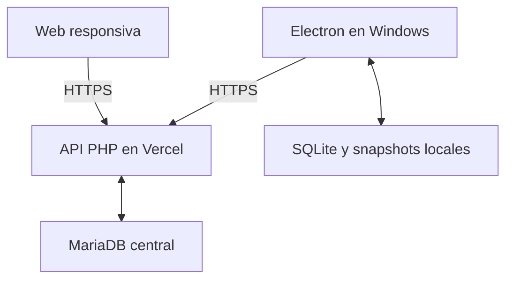

# T8 — Definir cómo funcionarán las partes del sistema

## Identificación

| Dato | Valor |
| --- | --- |
| Fase | 3.0 — Diseño de arquitectura e interfaz |
| Responsable documental | Oscar Aarón Delgadillo Fernández (OD) |
| Inicio previsto | 10 de septiembre de 2026 |
| Fin previsto | 14 de septiembre de 2026 |
| Preparación del diseño | 18 de noviembre de 2026 |
| Estado | Arquitectura propuesta para implementación; revisión conjunta en T14 |

Las fechas previstas se conservan del cronograma. Este diseño no acredita software ejecutado o servicios desplegados. Se desarrolla sobre los acuerdos de T1 y la especificación candidata T5; T7 conserva pendientes de aprobación y no se declara cerrado por continuar con el diseño.

## Objetivo y alcance

Definir componentes, responsabilidades, comunicación, límites de confianza y comportamiento ante desconexión para construir la web, la API, el almacenamiento central y el escritorio Windows. Insumos: [T1](../gestion/T01_revision_documental.md), [T5](../gestion/T05_funciones_condiciones.md), [T6](../gestion/T06_organizacion_prioridades.md), [T7](../gestion/T07_revision_aprobacion_requisitos.md), alcance, EDT y planes de calidad y riesgos.

El desarrollo del sistema, sus pruebas y empaquetado forma parte del trabajo solicitado. Los roles DA/PC/OD/BG son la asignación documental de cada entrega; el asistente implementará las tareas y el usuario realizará los commits. El acceso a cuentas y verificaciones personales de proveedores requerirá intervención del usuario cuando corresponda.

## Vista general

El servidor MariaDB se propone en alwaysdata para la demostración académica. Web y Electron nunca reciben sus credenciales. La base local sirve al escritorio; no es una base compartida en una carpeta de red ni un archivo que se intercambia directamente con el servidor.

## Componentes y responsabilidades

| Componente | Responsabilidad | Límite |
| --- | --- | --- |
| Interfaz compartida HTML/CSS/JS | Formularios, navegación, historial, estados de guardado y presentación de errores | Sin SQL, secretos ni decisiones finales de autorización |
| Adaptador web | Consultar y modificar datos mediante API; manejar sesión y errores de conexión | No promete persistencia offline del navegador |
| Adaptador de escritorio | Exponer operaciones clínicas locales mediante el puente seguro de Electron | Sin acceso directo de la página a archivos o Node.js |
| Proceso principal Electron | Gestionar SQLite, transacciones, snapshots, cola y ciclo de vida de escritorio | No almacenar credenciales del servidor MariaDB |
| Motor de sincronización del escritorio | Reintentar cambios, recibir actualizaciones y mostrar pendientes/conflictos | No descartar operaciones por una respuesta incierta |
| API PHP | Autenticar, autorizar, validar, ejecutar reglas clínicas de captura y sincronización | Sin estado clínico persistente en archivos temporales de Vercel |
| MariaDB central | Datos compartidos, identidades de operaciones, versiones e historial de cambios | Solo backend y acceso administrativo controlado |

Se propone una API organizada por dominio en una sola base de código. No se necesitan microservicios, colas externas ni otro motor de base de datos para este alcance. La compatibilidad del runtime PHP y del transporte a MariaDB se comprobará antes de considerar viable el despliegue.

## Reutilización entre web y escritorio

Una misma interfaz usará un contrato de acceso a datos con operaciones de propietarios, pacientes, consultas, carnet e historial. Dos adaptadores implementarán ese contrato: web mediante HTTP y escritorio mediante IPC restringido. La interfaz no decidirá si ejecuta SQL o construye una sincronización.

Las operaciones de usuario y las operaciones de sincronización son distintas. Guardar en SQLite puede completar una acción del usuario aunque el envío al servidor siga pendiente. En web, solo la confirmación válida del servidor acredita guardado. Los contratos y pruebas deben comprobar que los resultados se presentan de forma equivalente sin ocultar esa diferencia.

La validación de presentación puede compartirse en JavaScript, pero PHP debe volver a validar cada solicitud. Los límites de acceso y las reglas de negocio no se delegan al navegador. Las reglas acordadas se documentan y se verifican mediante casos comunes para evitar divergencias entre clientes.

## Módulos funcionales

| Módulo | Operaciones previstas | Requisitos |
| --- | --- | --- |
| Identidad y permisos | Inicio/cierre de sesión, información de cuenta y control de acciones | RE12 |
| Propietarios | Alta, consulta, edición y baja lógica | RE01 |
| Pacientes | Alta multiespecie, consulta, edición, vínculo con propietario y baja lógica | RE02 |
| Expediente | Consultas, tratamiento, observaciones y seguimiento | RE03 |
| Carnet | Vacunas, desparasitaciones y próxima fecha opcional | RE04 |
| Historial | Consulta cronológica de eventos de un paciente | RE05, RE13 |
| Sincronización | Pendientes, intercambio, confirmaciones, conflictos y versiones conservadas | RE07, RE08, RE14 |
| Recuperación local | Snapshots, inspección y restauración controlada | RE09 |

Las relaciones definitivas del seguimiento, los campos obligatorios y algunas convenciones de captura siguen candidatas en D-T5-01/02/03. Esta arquitectura admite su ajuste en T9 sin atribuir una aprobación no recibida. No agrega portal de propietarios, facturación, inventario o prescripción automática.

## Contratos de comunicación propuestos

La API tendrá un prefijo de versión, por ejemplo `/api/v1`. Las rutas definitivas y sus esquemas se escribirán al implementar la comunicación; el enrutamiento deberá adaptarse al runtime PHP elegido sin asumir que archivos PHP sueltos se ejecutan automáticamente en Vercel.

| Grupo | Operación conceptual |
| --- | --- |
| Sesión | Autenticar, consultar contexto de usuario y cerrar sesión |
| Propietarios / pacientes | Crear, listar con paginación, consultar por ID, modificar y dar de baja lógicamente |
| Consultas / carnet | Crear eventos, listar por paciente y modificar conservando trazabilidad |
| Historial | Recuperar eventos del paciente con orden y límites claros |
| Sincronización | Enviar operaciones identificadas, consultar confirmaciones y recibir cambios por cursor |
| Conflictos | Consultar versiones conservadas y registrar una resolución autorizada |
| Salud técnica | Respuesta mínima para verificar disponibilidad, sin secretos o datos de pacientes |

Datos en JSON, errores estructurados y códigos HTTP apropiados. Cada error debe distinguir validación, autenticación, permiso, conflicto, indisponibilidad y fallo interno. Los mensajes visibles no contendrán SQL, credenciales o trazas del servidor.

Las listas se paginan; el historial completo debe poder recorrerse sin descargar todos los pacientes. El ID del paciente se comprueba en servidor y no basta con ocultarlo en la navegación. Los guardados web también necesitan identidad de operación o clave de idempotencia: un reintento tras perder la respuesta no debe duplicar una consulta.

## Flujos de persistencia

### Guardado desde escritorio

1. La interfaz envía una operación validada al adaptador local mediante IPC.
2. El proceso principal verifica contrato y permiso local, y aplica el cambio en SQLite junto con la operación pendiente dentro de una transacción.
3. Se registra el material necesario para el snapshot por guardado de consulta, según el diseño de T13. La coherencia entre transacción y copia se deberá resolver y probar, no asumir.
4. Solo después del commit local la interfaz muestra “Guardado local”; si procede, indica “Pendiente de sincronización”.
5. El motor intenta enviar cambios cuando haya conexión. Una falla de red no revierte una consulta ya guardada localmente.

La ruta y permisos del archivo SQLite deben estar en el almacenamiento de usuario de Electron, separados del código instalado. La actualización del instalador no debe borrar los datos. Las migraciones y la recuperación antes de modificar esquemas se definirán en T9/T13/T16.

### Guardado desde web

1. La interfaz envía una solicitud autenticada al backend.
2. PHP valida permisos y datos, y ejecuta la modificación con identidad de operación y trazabilidad en una transacción central.
3. El backend confirma el resultado; la pantalla solo entonces muestra guardado confirmado.
4. Si la respuesta se pierde, consultar/reintentar con la misma identidad debe devolver el resultado sin duplicar el evento.

La web no depende del proceso Electron ni de que la computadora Windows esté encendida. No se ejecuta un túnel al equipo del usuario para alojar la aplicación.

## Diseño de sincronización

### Identidad y trazabilidad

Se proponen identificadores generables offline para entidades y operaciones, un identificador de instalación/dispositivo, versión base y marcas técnicas. T9 fijará los campos y claves. Las fechas clínicas no determinan qué modificación prevalece: una atención antigua puede capturarse hoy sin volverse automáticamente una versión obsoleta.

La cola persiste en SQLite. Una confirmación de transporte no basta para eliminar un pendiente: debe existir confirmación durable de aplicación o reconocimiento de operación ya procesada. Si PHP falla tras confirmar en MariaDB pero antes de responder, el reintento debe reconocer la operación.

### Envío y recepción

- Enviar lotes limitados, preservando dependencias de datos, como propietario antes que paciente y paciente antes que consulta.
- El servidor registra operaciones aplicadas y devuelve resultados por operación, incluidas las rechazadas o en conflicto.
- La recepción usa cursor de cambios y paginación; cada lote se aplica transaccionalmente en SQLite antes de avanzar el cursor local.
- Reintentos temporales utilizan espera progresiva; errores de validación o permiso requieren intervención y no se reintentan indefinidamente como fallos de red.
- Una baja lógica también se propaga; no se sincroniza como eliminación física que deje referencias huérfanas.
- Al cerrar la aplicación se intenta el envío dentro de un tiempo controlado; ante cierre forzado, los pendientes sobreviven para el siguiente inicio.

### Conflictos y relojes

Se conserva la política LWW de los documentos, con historial de versiones desplazadas y desempate determinista. No se utilizará ingenuamente la hora del dispositivo como única autoridad. T9/T35 deberán definir normalización temporal, versión base, detección de desalineación y criterio de desempate para obtener resultados repetibles.

Las operaciones concurrentes que no se puedan resolver conforme a esa política se conservan para revisión. Resolver manualmente genera una nueva operación trazable; no borra el conflicto como si nunca hubiera existido. La versión desplazada debe ser recuperable y su relación con la ganadora verificable.

La copia local puede estar desactualizada. La interfaz debe mostrar último intercambio confirmado y pendientes; “Sincronizado” describe la confirmación disponible, no una garantía permanente de que nadie más haya editado después.

## Seguridad y límites de confianza

| Límite | Control propuesto |
| --- | --- |
| Navegador a API | HTTPS, autenticación y autorización en servidor; estrategia de sesión y protección de solicitudes en T12 |
| Electron: interfaz a proceso principal | Aislamiento de contexto, sin integración Node en la página, sandbox cuando corresponda y API mínima de preload |
| IPC | Lista explícita de operaciones, validación de argumentos y origen; sin SQL arbitrario ni acceso genérico a archivos |
| API a MariaDB | Credenciales solo en entorno de backend, usuario de privilegios mínimos, transporte cifrado y validación del certificado |
| Datos locales | Directorio de usuario, acceso controlado, exclusión de Git y política de protección en T12/T13 |
| Sesión offline | Habilitación explícita, alcance y vencimiento definidos en T12; nunca derivar autorización solo de que SQLite exista |
| Logs y evidencia | Identificadores técnicos y errores sanitizados; sin contraseñas, tokens o contenido clínico innecesario |

Una revocación remota no puede conocerse instantáneamente en un dispositivo desconectado. T12 debe definir y comunicar esa limitación y la vigencia máxima de autorización offline. Al reconectar se revalida identidad y permiso, conservando operaciones rechazadas para un tratamiento explícito sin pérdida silenciosa.

No se promete cifrado local completo por usar SQLite. Su necesidad, mecanismo y manejo de claves se evalúan en la tarea de seguridad, evitando declarar controles que aún no están implementados.

## Despliegue y configuración

| Ambiente | Propósito | Datos |
| --- | --- | --- |
| Desarrollo | Ejecutar y depurar localmente; servidor PHP y bases de prueba | Ficticios |
| Pruebas/staging | Integración, compatibilidad y sincronización contra infraestructura externa | Ficticios, con credenciales distintas |
| Demostración | Versión escolar identificada y accesible por enlace | Ficticios |
| Operación clínica eventual | Instalación y servicios con condiciones de uso y controles adecuados | Requiere decisión separada y validación previa |

Las vistas previas de Vercel no deben modificar por accidente la base de la demostración. Configurar por ambiente URL de API, conexiones de prueba y secretos; no incrustarlos en el instalador o JavaScript público. El cliente de escritorio conoce la URL del servicio y sus credenciales de usuario, no el host/usuario/contraseña de MariaDB.

La propuesta es servir frontend y API desde un mismo origen para simplificar sesiones web. Las solicitudes de Electron necesitan tratamiento explícito de origen y autenticación; CORS no se utiliza como sustituto de los permisos.

Siempre se conserva una exportación y un procedimiento de recuperación de la base central. Un snapshot local de un expediente no equivale a respaldo de MariaDB. Retención, restauración, pérdida tolerable y pruebas se concretarán en T13 y tareas de respaldo, sin prometer objetivos no medidos.

## Organización propuesta del código

Los directorios siguientes son una estructura prevista; no se crean en T8 para simular implementación.

| Ruta propuesta | Contenido |
| --- | --- |
| `web/` | Entrada web, vistas y recursos de interfaz |
| `shared/` | Componentes y contratos JS reutilizables sin secretos |
| `desktop/` | Entradas Electron, preload, IPC, SQLite y sincronización |
| `api/` | Entrada y enrutamiento PHP para Vercel |
| `server/` | Dominio, validaciones y repositorios PHP fuera del directorio estático |
| `database/` | Migraciones y datos ficticios para SQLite/MariaDB |
| `tests/` | Pruebas significativas de permisos, persistencia, sincronización y recuperación |
| `docs/` | Gestión, arquitectura, manual y referencias de evidencia |

La configuración de despliegue debe impedir que código del servidor, migraciones, pruebas o documentos internos se publiquen como recursos estáticos. La estructura final se verifica al preparar herramientas y enrutamiento.

## Verificaciones técnicas antes de construir sobre la arquitectura

| Verificación | Momento | Resultado requerido |
| --- | --- | --- |
| PHP en Vercel | T15/T18 | Ruta ejecutable, JSON y errores controlados usando runtime compatible |
| Vercel a MariaDB | T18 | Conexión externa cifrada con validación de certificado, consulta y escritura transaccional |
| Persistencia central | T18 | Datos conservados entre invocaciones; sin depender del disco de la función |
| Autenticación web y Electron | T12/T19 | Contratos de sesión viables en ambos clientes y permisos verificados |
| SQLite desde Electron | T16 | Ruta correcta, creación y reapertura con datos conservados |
| Frontera IPC | T16/T17 | Solo operaciones previstas; rechazo de entradas y acceso genérico |
| Reintentos y conflictos | T31/T33/T35/T41 | Duplicados evitados y versiones conservadas con evidencia diferenciada de mocks |
| Restauración | T37/T47 | Recuperación aislada sin sobrescritura silenciosa |

Si PHP o el acceso seguro a MariaDB no funcionan bajo las condiciones del proveedor, se registra el bloqueo y se presenta una alternativa antes de cambiar el stack. No se sustituye MariaDB por otro motor ni PHP por otro lenguaje de manera silenciosa.

## Criterios de cierre y siguiente tarea

- [x] Definir componentes y responsabilidades para web, escritorio, API y almacenamiento.
- [x] Distinguir guardado local, guardado central y sincronización.
- [x] Identificar contratos, límites de confianza, conflictos y recuperación.
- [x] Delimitar ambientes y estructura de código propuesta.
- [x] Registrar pruebas técnicas pendientes sin atribuir despliegue realizado.
- [x] Conservar responsable, fechas y decisiones abiertas de T5/T7.

Resultado: diseño T8 preparado. No es una aprobación conjunta de diseño ni evidencia de implementación.

Siguiente tarea: T9 — Organizar la información de propietarios y pacientes; responsable Oscar Aarón Delgadillo Fernández; ventana documental del 11 al 16 de septiembre de 2026. Se definirá el modelo de datos local y central, conservando como candidatas las relaciones y campos aún pendientes.
