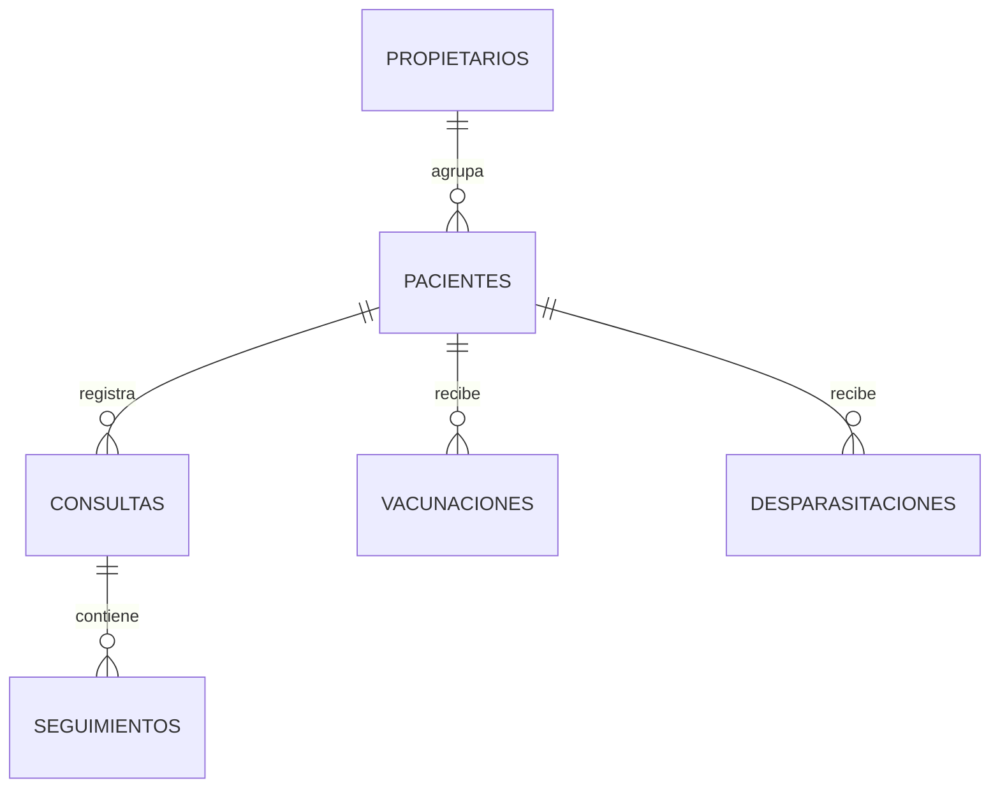

# T9 — Organizar la información de propietarios y pacientes

## Identificación

| Dato | Valor |
| --- | --- |
| Fase | 3.0 — Diseño de arquitectura e interfaz |
| Responsable documental | Oscar Aarón Delgadillo Fernández (OD) |
| Inicio previsto | 11 de septiembre de 2026 |
| Fin previsto | 16 de septiembre de 2026 |
| Preparación del modelo | 18 de noviembre de 2026 |
| Versión | Modelo lógico candidato 0.1 |
| Estado | Preparado para diseño e implementación posterior; revisión conjunta en T14 |

Las fechas previstas corresponden al cronograma. Este documento define el modelo: no ejecuta migraciones ni acredita bases creadas. Las convenciones D-T5-01/02/03 permanecen como propuestas y no se consideran aprobadas por continuar el trabajo.

## Objetivo y fuentes

Definir entidades, relaciones, claves, tipos, integridad y correspondencia entre SQLite local y MariaDB central para soportar RE01–RE09 y RE12–RE14. Fuentes: alcance, diccionario EDT, formatos físicos y los registros [T3](../gestion/T03_revision_formatos_medicos.md), [T5](../gestion/T05_funciones_condiciones.md), [T7](../gestion/T07_revision_aprobacion_requisitos.md) y [T8](T08_arquitectura_sistema.md).

Se amplía el detalle técnico de propietarios y pacientes hasta los eventos que forman su expediente; no se incorporan inventario, facturación, agenda ni portal de propietarios. Los pacientes son animales, no cuentas de acceso. Los responsables documentales no se convierten en cuentas clínicas por defecto.

## Relaciones clínicas

Un paciente tiene un propietario de referencia. La relación seguimiento–consulta y la independencia de los eventos sanitarios respecto de una consulta son candidatas D-T5-01. No se agrega una entidad episodio ni múltiples propietarios por paciente sin decisión de alcance. Los registros sanitarios permanecen consultables en el historial aunque no exista una consulta asociada.

## Convenciones de representación

| Concepto | Convención propuesta |
| --- | --- |
| Identidad de entidades | UUID generado antes del guardado, representado en minúsculas; no usar nombre, teléfono o ID autoincremental local para sincronizar |
| Identidad de revisiones y operaciones | UUID independiente por revisión y por operación; un reintento conserva ambos |
| Texto | Unicode; nombres visibles sin transformación destructiva; normalización separada para búsqueda |
| Vacíos opcionales | NULL; no usar cero, fecha ficticia o texto “N/A” para representar ausencia |
| Fecha clínica | Día calendario `YYYY-MM-DD`, sin convertirlo en medianoche UTC |
| Instante técnico | UTC con precisión acordada y representación canónica; conversión de pantalla a la zona de la clínica |
| Peso | Entero en gramos, presentado en kg; admite tres decimales de kg sin depender de coma flotante |
| Temperatura | Entero en centésimas de °C, presentado con hasta dos decimales |
| Frecuencias | Enteros, con unidad visible; latidos/min y respiraciones/min como propuesta D-T5-03 |
| Texto clínico | Texto multilínea; límite técnico candidato de 10,000 caracteres por campo, verificable antes de aceptar, sin truncamiento silencioso |
| Identificación breve | Límite candidato de 200 caracteres para nombres, raza y producto; teléfono 50; domicilio 500; localidad 200 |

Los límites anteriores son técnicos y candidatos: no representan rangos veterinarios ni justificación para descartar información. Si una entrada excede un límite, la API debe rechazarla con explicación y conservar la captura en pantalla, no cortarla. La precisión admitida se aplica igual en ambos motores y en la API.

## Tablas clínicas compartidas

Cada tabla clínica incluye los campos de metadatos definidos después. “Requerido” distingue integridad relacional de los mínimos de captura propuestos en T5. Hasta confirmar D-T5-02, la obligatoriedad clínica sigue candidata.

### propietarios

| Campo | Tipo lógico | Condición / propósito |
| --- | --- | --- |
| id | UUID | Clave primaria |
| nombre | Texto breve | Mínimo propuesto de captura |
| telefono | Texto, nullable | Conservar prefijos; no tratar como número aritmético |
| domicilio | Texto, nullable | Contacto del propietario |
| localidad | Texto, nullable | Campo distinto al domicilio |

No se define unicidad sobre nombre o teléfono. Dos propietarios pueden compartir nombre, domicilio o teléfono; una coincidencia permite advertir posibles duplicados, no fusionarlos automáticamente. Las búsquedas se apoyan en nombre normalizado y contacto sin alterar el dato original.

### pacientes

| Campo | Tipo lógico | Condición / propósito |
| --- | --- | --- |
| id | UUID | Clave primaria |
| propietario_id | UUID | FK requerida a propietarios |
| nombre_identificacion | Texto breve | Nombre o identificación del animal; mínimo propuesto |
| especie | Código textual | perro, gato, caballo, vaca, borrego u otra; mínimo propuesto |
| especie_otra | Texto, nullable | Propuesta: descripción cuando especie sea otra |
| raza | Texto, nullable | Sin catálogo obligatorio no acordado |
| fecha_nacimiento | Fecha, nullable | Nacimiento conocido, nunca inferido como exacto a partir de estimación |
| edad_estimada_valor | Entero, nullable | Estimación aportada |
| edad_estimada_unidad | Código, nullable | dias, meses o anios |
| edad_estimada_referencia | Fecha, nullable | Día al que corresponde la estimación |

La política propuesta es nacimiento conocido o conjunto completo de estimación, sin coexistencia activa de datos contradictorios; ambos pueden faltar si se desconoce la edad. Al pasar de estimación a nacimiento conocido, se conserva la revisión anterior y no se reescriben edades históricas.

El paciente no tiene un “peso actual” mutable como sustituto de sus mediciones históricas. Puede mostrarse el último peso disponible, indicando evento y fecha de origen. No se agrega sexo, fotografía, microchip o campos no aportados al alcance por conveniencia de diseño.

### consultas

| Campo | Tipo lógico | Condición / propósito |
| --- | --- | --- |
| id | UUID | Clave primaria |
| paciente_id | UUID | FK requerida a pacientes |
| fecha_atencion | Fecha | Fecha clínica requerida |
| peso_g | Entero, nullable | Peso en este evento |
| temperatura_centesimas | Entero, nullable | Temperatura medida en este evento |
| frecuencia_cardiaca | Entero, nullable | FC medida |
| frecuencia_respiratoria | Entero, nullable | FR medida |
| diagnostico_motivo | Texto clínico | Mínimo propuesto D-T5-02; sin diagnóstico automático |
| tratamiento | Texto clínico, nullable | Indicación del veterinario |
| observaciones | Texto clínico, nullable | Notas generales |
| edad_registrada | Objeto de captura, nullable | Edad conocida/estimada al evento, con valor/unidad o fuente de cálculo |

`edad_registrada` se define como estructura versionada del evento, no texto que se recalcula usando siempre la fecha actual. Su representación física se fijará en las migraciones; debe permitir reconstruir la fuente y fecha de referencia de la edad mostrada. No hay columna de presión arterial.

### seguimientos

| Campo | Tipo lógico | Condición / propósito |
| --- | --- | --- |
| id | UUID | Clave primaria |
| consulta_id | UUID | FK requerida propuesta por D-T5-01 |
| fecha | Fecha | Fecha del seguimiento |
| aplicacion | Texto clínico | Descripción libre propuesta; sin inferir dosis, firma o vía |
| observaciones | Texto clínico, nullable | Notas del seguimiento |

El paciente se obtiene mediante la consulta para evitar dos referencias que puedan contradecirse. Si se necesita consultar por paciente eficientemente se utiliza un JOIN o vista; no se introduce una copia sin control del paciente_id.

### vacunaciones

| Campo | Tipo lógico | Condición / propósito |
| --- | --- | --- |
| id | UUID | Clave primaria |
| paciente_id | UUID | FK requerida a pacientes |
| vacuna | Texto breve | Nombre o descripción requerida propuesta |
| fecha_aplicacion | Fecha | Fecha del evento |
| aplicacion | Texto clínico, nullable | Encabezado del papel conservado como texto candidato |
| proxima_fecha | Fecha, nullable | Elegida por el veterinario; ausencia no genera recordatorio |

### desparasitaciones

| Campo | Tipo lógico | Condición / propósito |
| --- | --- | --- |
| id | UUID | Clave primaria |
| paciente_id | UUID | FK requerida a pacientes |
| producto | Texto breve | Desparasitante registrado; sin catálogo clínico obligatorio |
| fecha_aplicacion | Fecha | Fecha del evento |
| peso_g | Entero, nullable | Peso asociado al evento; no sobrescribe consulta anterior |
| proxima_fecha | Fecha, nullable | Opcional, elegida por el veterinario |

No se almacenan recordatorios como una segunda fecha que pueda divergir: la pantalla los deriva de proxima_fecha y de la fecha de consulta del listado. No se generan correos/SMS ni calendarios de aplicación automáticos.

## Metadatos comunes de entidades clínicas

| Campo | Uso |
| --- | --- |
| creado_en | Instante técnico de creación |
| creado_por | ID de usuario que originó el registro |
| modificado_en | Instante técnico de edición; no es la fecha clínica |
| modificado_por | ID de usuario que originó la revisión vigente |
| revision_actual_id | UUID de la versión visible; referencia lógica al historial de versiones |
| inactivo_en | Instante nullable de baja lógica |
| inactivado_por | Usuario nullable que la realizó |

La hora del cliente no se trata como prueba suficiente de precedencia o identidad. El servidor valida usuario y dispositivo y agrega su hora de recepción. Las marcas originales se conservan para trazabilidad. Una corrección no cambia creado_por ni la fecha clínica automáticamente.

Las FK de autoría apuntan a usuarios conservados como referencias de identidad. Desactivar una cuenta no elimina sus registros ni su nombre histórico de autoría. En SQLite solo se replica el perfil mínimo necesario, sin hashes de contraseñas centrales ni sesiones web.

Para evitar ciclos de inserción entre entidad y versión, revision_actual_id se trata inicialmente como referencia lógica validada en la transacción, no como FK inmediata que obligue a insertar primero dos filas que dependen entre sí. El historial de versiones se identifica por tipo_entidad y entidad_id; su integridad polimórfica se comprueba en el repositorio, sin simular una FK SQL a seis tablas.

## Identidad, versiones e intercambio

| Tabla o registro | Ubicación | Campos esenciales / responsabilidad |
| --- | --- | --- |
| usuarios | Central; réplica mínima local | id, nombre, identificador_login único, rol, estado; hash de contraseña solo central |
| dispositivos | Central y datos de la instalación local | id, usuario/instalación autorizada, estado y último intercambio; identificador de dispositivo no sustituye autenticación |
| sesiones | Central | Sesiones revocables según T12; tokens o identificadores protegidos y sin replicar secretos a datos clínicos |
| versiones_entidad | Central y copia local según política | revision_id único, tipo_entidad, entidad_id, revision_base_id, usuario, dispositivo, operación, marcas y contenido completo de esa revisión |
| conflictos | Central y réplica local necesaria | id, entidad, revisiones concurrentes, estado y revisión de resolución; conservar el vínculo incluso después de resolver |
| operaciones_recibidas | Central | operacion_id único, usuario/dispositivo, huella de carga, estado y resultado durable para idempotencia |
| cambios_servidor | Central | secuencia de cambio monotónica, entidad/revisión y operación; fuente de paginación de recepción |
| cola_sincronizacion | Solo SQLite | operacion_id, entidad/revisión, revisión base, carga estable, orden local, intentos, estado y último error sanitizado |
| estado_sincronizacion | Solo SQLite | Ámbito de réplica, último cursor confirmado, última sincronización y datos de ejecución del proceso |
| snapshots_locales | Solo almacenamiento local | Manifiesto de snapshot, entidad/revisión, archivo o contenido, checksum, instante y estado de verificación; diseño físico en T13 |
| migraciones_esquema | Cada motor | Versión de esquema y migraciones aplicadas; no sincronizar como datos clínicos |

Los perfiles, sesiones y dispositivos no se editan offline mediante la misma cola clínica. El alcance de réplica y la autorización local se fijarán en T12; no se enviarán a un cliente datos a los que no tenga acceso. Todas las consultas de cambio y conflicto aplican permisos, no solo los endpoints clínicos.

### Transacción de una operación central

1. Verificar autenticación, permiso y que el tipo de entidad sea admitido.
2. Consultar operacion_id. Si existe con misma identidad y huella de carga, devolver el resultado durable; si la carga difiere, rechazar el reuso de ID.
3. Verificar referencias y versión base, conservar la revisión recibida y detectar concurrencia.
4. Actualizar la versión visible solo conforme a la política de conflictos, y registrar versiones desplazadas y conflictos cuando corresponda.
5. Persistir el resultado y el cambio publicable en la misma transacción central. Confirmar antes de responder.

No basta un contador autoincremental consultado sin control para garantizar un cursor seguro ante transacciones concurrentes: T34 debe garantizar que una fila con secuencia menor no pueda confirmar después de que un cliente haya avanzado más allá de ella. Se propone serializar la asignación/publicación mediante un registro de control bloqueado dentro de la transacción o una estrategia equivalente probada. Debe existir un caso de prueba de confirmaciones fuera de orden.

### Transacción local

Guardar entidad, revisión y operación pendiente de forma atómica. Un cierre antes del commit no produce un mensaje de éxito. Un cierre después del commit conserva la operación para reintento. Durante recepción, aplicar cambios y avanzar el cursor juntos, sin volver a encolar los cambios recibidos como si fueran ediciones locales nuevas.

No reemplazar una entidad con cambios locales pendientes por una copia remota sin comparar versiones y conservar el contenido local. Confirmar una operación anterior tampoco permite marcar como sincronizada una revisión local más nueva que sigue pendiente.

### Política LWW

revision_base_id detecta ediciones que no parten de la revisión visible actual. Las ramas y el contenido desplazado se conservan. El orden LWW definitivo, incluyendo reloj desalineado y desempate, se concretará en T35; no se usa la fecha de atención, el UUID ni la hora de llegada como sustituto implícito de esa política. La resolución manual crea otra revisión con autoría y relación a las versiones resueltas.

## Mapeo entre motores

| Tipo lógico | MariaDB propuesto | SQLite propuesto | Regla de intercambio |
| --- | --- | --- | --- |
| UUID | CHAR(36), comparación consistente | TEXT con comprobación de formato | Cadena canónica |
| Texto breve | VARCHAR con límite candidato | TEXT con CHECK de longitud | Unicode, sin truncar |
| Texto clínico | TEXT | TEXT | JSON escapado sin perder saltos de línea |
| Entero de medición | INTEGER o BIGINT según dominio | INTEGER | Entero en unidad de almacenamiento, sin flotantes |
| Fecha | DATE | TEXT con validación de calendario | YYYY-MM-DD |
| Instante | DATETIME con precisión definida, UTC | TEXT canónico UTC | Cadena con zona UTC y precisión fija |
| Objeto de versión/edad | JSON o TEXT validado según versión desplegada | TEXT JSON validado | Esquema de carga versionado y serialización canónica para huella |
| Secuencia central | BIGINT central | INTEGER para cursor recibido | Evitar pérdida de precisión en JS: representar como cadena decimal en transporte |

Las migraciones fijarán restricciones equivalentes y probarán la versión concreta de cada motor. SQLite debe habilitar FK en cada conexión que las necesite; la aplicación no puede asumir su activación por crear tablas. Esquema común no significa ejecutar sin adaptación el mismo DDL en MariaDB y SQLite.

## Integridad, bajas e índices

- FK propietario–paciente y paciente–eventos; FK consulta–seguimiento según propuesta; no aplicar eliminación en cascada a historias clínicas.
- Validar relaciones dentro de transacciones. Una baja lógica no se usa para eludir FK ni elimina versiones.
- Propuesta D-T5-02/03: peso/FC/FR presentes positivos; mediciones ausentes NULL; sin umbrales clínicos inventados. Fechas válidas y relación nacimiento/evento/próxima fecha conforme a T5 una vez confirmadas.
- Propuesta: paciente inactivo no admite atención nueva hasta reactivación autorizada; la consulta histórica permanece disponible. Política exacta de baja de propietario con pacientes activos a definir en T12, sin cascada silenciosa.
- Índices por propietario_id en pacientes; por paciente_id, fecha e id en consultas y eventos; por consulta_id, fecha e id en seguimientos.
- Índices de búsqueda por nombre normalizado; no convertirlos en restricciones UNIQUE.
- Índices por entidad y revisión en historial; UNIQUE en revision_id y operacion_id; índice por estado/orden local de cola y por secuencia de cambios.
- Las búsquedas y la paginación usan un orden estable, con ID como desempate; las fechas iguales no deben omitir o repetir eventos al recorrer el historial.

No se limita el historial a una cantidad arbitraria de filas de papel. La paginación controla el tamaño de respuesta, no borra eventos antiguos.

## Consultas y vistas de aplicación

| Vista o consulta lógica | Origen | Consideración |
| --- | --- | --- |
| Lista de pacientes | pacientes y propietario | Identificar homónimos y estado sin mostrar toda la historia clínica |
| Historial | consultas, seguimientos y carnet | No persistir una copia independiente del historial que pueda divergir |
| Último peso | Consultas/desparasitaciones con peso | Mostrar origen y fecha; no modificar el peso de otros eventos |
| Próximas aplicaciones | Vacunaciones/desparasitaciones con proxima_fecha no NULL | Diferenciar próxima/vencida; no inferir una fecha ausente |
| Estado local | Cola y revisiones confirmadas | Distinguir dato guardado localmente, pendiente, confirmado y conflicto |
| Versiones de un registro | versiones_entidad y conflictos | Restringir acceso según permisos y conservar autoría |

## Verificación prevista del modelo

| Caso | Resultado exigido al implementar |
| --- | --- |
| Dos animales con el mismo nombre | IDs distintos y selección sin fusionar |
| Consulta con paciente inexistente | Rechazo íntegro, sin filas huérfanas |
| Baja de paciente con historia | Historia y versiones conservadas |
| Edad aproximada sin nacimiento | Sin fecha ficticia; referencia de estimación conservada |
| Cambio posterior de nacimiento | Edad previamente registrada recuperable mediante historia/versiones |
| Próxima aplicación vacía | Sin recordatorio ni fecha sustituta |
| Reintento de operación ya confirmada | Mismo resultado sin duplicación |
| Mismo ID de operación con carga diferente | Rechazo explícito |
| Edición concurrente | Versiones completas conservadas y resultado determinista según política definida |
| Recepción mientras existe edición local pendiente | Contenido local no perdido ni marcado falsamente como enviado |
| Cambios centrales concurrentes | Cursor sin saltos de transacciones que confirman después |
| Reinicio antes/después de commit local | Sin éxito ficticio antes; datos y pendiente recuperables después |
| Precisión numérica y secuencias grandes | Misma medición tras ida/vuelta y sin redondear secuencias por JS |

Estos casos son criterios futuros; no hay migraciones ni pruebas de motores ejecutadas en T9. Las migraciones de SQLite se implementan al preparar almacenamiento; las centrales en la comunicación/API. El repositorio solo contendrá datos ficticios reproducibles, no bases clínicas reales.

## Pendientes de diseño y cierre

| Pendiente | Tratamiento |
| --- | --- |
| D-T5-01/02/03 | Mantener candidatas las relaciones y reglas que dependen de ellas; actualizar modelo si el usuario decide cambios |
| Permisos y sesión offline | T12: perfiles mínimos locales, vigencia, revocación y autorización de sincronización |
| Snapshot y retención | T13/T36: representación física, checksum y recuperación coordinada con transacciones |
| Relojes y desempates | T35: orden LWW, desalineación y evidencia de versiones |
| Capacidad y conectividad del proveedor | T18: probar configuración real sin asumir que el diseño implica conexión disponible |

- [x] Definir seis entidades clínicas y sus relaciones.
- [x] Separar datos del propietario, identificación del animal y observaciones clínicas por evento.
- [x] Definir identidad offline, metadatos, versiones, operaciones y cursor de recepción.
- [x] Proponer representación equivalente SQLite/MariaDB y conservación del historial.
- [x] Registrar restricciones, índices y casos relevantes de integridad.
- [x] Mantener explícitas las decisiones de captura pendientes.

Resultado: modelo lógico T9 preparado para revisión T14 e implementación posterior. No se declara aprobación de requisitos ni creación de bases.

Siguiente tarea: T10 — Diseñar las pantallas principales de escritorio; responsable Diego Alonso Coronel Vargas; ventana documental del 14 al 17 de septiembre de 2026.
